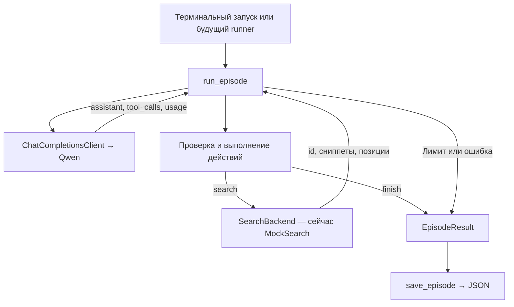

# Тестирование и архитектура харнесса поискового агента

Состояние на 2026-10-31. Живой эпизод проверен на первой версии API-адаптера; последующее исправление терминального запуска добавляет вывод прогресса, общий таймаут и сохранение при отмене.

Харнесс проходит полный цикл с настоящей Qwen через настроенный API: получает вопрос, выполняет выбранный моделью поиск, возвращает выдачу в историю и принимает финальный список документов. Поиск пока подставной. Уже можно проверять протокол работы агента в терминале и подключать реальный поиск по согласованному интерфейсу.

## Проверенные результаты

| Проверка | Результат |
|---|---|
| Автоматические проверки | 53 теста прошли, без внешних API, ключей и GPU |
| Модель в живом эпизоде | `qwen/qwen3.5-9b` через настроенный Chat Completions API |
| Провайдер в живом эпизоде | PrimeIntellect |
| Действия | `search({"query": "перенос срока проекта"})`, затем `finish({"document_ids": ["doc-001", "doc-002"]})` |
| Завершение | `finished`, два ответа модели и один поиск |
| Токены | 1473 входных и 67 выходных, всего 1540 |
| Стоимость по usage | $0.00026716 за успешный эпизод |
| Время эпизода | Около 4,65 секунды |

JSON живого эпизода сохранён локально в `runs/api-smoke/episode-success.json`. Каталог `runs/` не входит в Git. Стоимость в таблице относится к этому успешному эпизоду; отдельные диагностические запросы в неё не включены. Пример проверяет взаимодействие компонентов; качество поиска и отбора на бенчмарке пока не измерялось.

## Как устроен цикл



Модель выбирает запросы, число поисков и момент `finish`. Харнесс хранит историю, считает ресурсы и проверяет действия. Поиск получает запрос и корпус, но не управляет моделью. После каждого действия результат добавляется сообщением `role="tool"` с исходным `tool_call_id`; схемы инструментов передаются при каждом обращении к модели.

`finish` принимает только ранее показанные id, удаляет повторы с сохранением порядка и ограничивает длину списка. При ошибочных аргументах модель получает описание ошибки и может исправиться в пределах бюджета. Если бюджет заканчивается, результат содержит `truncated=true` и пустой финальный список; найденные документы остаются в истории.

### Модули и границы ответственности

| Модуль | Назначение |
|---|---|
| [contracts/types.py](../src/search_rl_env/contracts/types.py) | Типы задачи, выдачи, конфигурации, результата и async-интерфейсы |
| [agent/loop.py](../src/search_rl_env/agent/loop.py) | `run_episode`, история, учёт usage, остановка и атомарное JSON-сохранение |
| [agent/tools.py](../src/search_rl_env/agent/tools.py) | Схемы `search` и `finish`, проверка аргументов, id и поискового бюджета |
| [agent/prompts.py](../src/search_rl_env/agent/prompts.py) | Начальный промпт, вопрос и сообщения об оставшемся бюджете |
| [agent/client.py](../src/search_rl_env/agent/client.py) | Общий Chat Completions-клиент и адаптеры настраиваемого API и OpenRouter |
| [agent/auth.py](../src/search_rl_env/agent/auth.py) | Чтение ключа API из окружения или файла без его вывода в журнал |
| [agent/mocks.py](../src/search_rl_env/agent/mocks.py) | Детерминированные подставные модель и поиск |
| [examples/run_episode.py](../examples/run_episode.py) | CLI, выбор клиента, загрузка примера и вывод траектории |

### Интерфейсы для подключения

Для Димы достаточно реализовать метод поиска:

```python
from search_rl_env.contracts import SearchHit

class CorpusSearch:
    async def search(
        self,
        query: str,
        *,
        corpus_id: str,
        corpus_revision: str | None,
        limit: int,
    ) -> list[SearchHit]:
        ...
```

`SearchHit` содержит `doc_id`, `snippet` и `rank` от 1. Корпус и ревизию задаёт задача; модель не может заменить их аргументами инструмента. Харнесс сохраняет порядок выдачи, удаляет повторные id и ограничивает число документов и длину сниппетов.

Коля сможет вызывать харнесс без CLI:

```python
from search_rl_env.agent import run_episode, save_episode

result = await run_episode(task, model, search, config)
save_episode(result, output_path)
```

`AgentTask` содержит вопрос, язык, id задачи, корпус и его необязательную ревизию. Эталоны и split остаются у загрузчика и оценщика; неизвестные поля задачи отклоняются. `run_episode` возвращает результат без записи на диск. Runner выбирает путь, организует пакетный запуск, попытки, возобновление и оценку. Полный контракт — в [CONTRACTS.md](CONTRACTS.md).

## Ручное тестирование в терминале

Команды ниже выполняются из корня репозитория после установки по [README](../README.md#как-начать). Они используют `.venv/bin/python`, поэтому активировать окружение отдельно не требуется. Для каждого сценария указан отдельный файл: повторная запись в тот же путь заменяет предыдущий результат.

### Бесплатный полный цикл

```bash
.venv/bin/python examples/run_episode.py --model mock --verbose \
  --question 'Какие документы описывают перенос срока проекта?' \
  --output runs/manual/mock.json
```

Ожидается `search` → `finish`, документы `doc-001`, `doc-002`, `stop_reason=finished`, `truncated=false` и код выхода 0. Моковая модель выбирает все показанные документы в пределах лимита; её usage — синтетические счётчики для проверки цикла.

### Остановка по шагам и токенам

```bash
.venv/bin/python examples/run_episode.py --model mock --verbose \
  --max-steps 1 --output runs/manual/max-steps.json

.venv/bin/python examples/run_episode.py --model mock --verbose \
  --max-output-tokens 1 --output runs/manual/max-tokens.json
```

В первом случае ожидается `max_steps`, во втором — `max_output_tokens`. В обоих случаях поиск выполнен, финального выбора нет, `truncated=true`, код выхода 1 и JSON сохранён. Такой код выхода означает, что эпизод не завершился добровольным `finish`.

### Qwen через настроенный API

Это живой API-запуск с локально заданными адресом и авторизацией. Нужны `MODEL_API_URL`, `MODEL_ID` и `MODEL_API_KEY` либо `MODEL_API_KEY_FILE` в окружении или игнорируемом `.env`. Заголовок авторизации настраивается через `MODEL_AUTH_SCHEME`. На этой машине локальная конфигурация уже подготовлена.

```bash
.venv/bin/python examples/run_episode.py \
  --model api --model-id qwen/qwen3.5-9b \
  --question 'Какие документы описывают перенос срока проекта?' \
  --max-steps 4 --max-output-tokens 2048 --max-tokens-per-step 1024 \
  --verbose --request-timeout 30 --output runs/manual/api.json
```

Для этого вопроса уже проверено успешное завершение с обоими документами. Новый запуск может выбрать другой запрос или порядок действий. `--verbose` показывает отправку запроса, действия и выдачу по ходу эпизода; во время ожидания каждые 5 секунд выводится статус, в конце — usage. Поиск возвращает фиксированные сниппеты из [search_hits.json](../examples/fixtures/search_hits.json), поэтому произвольный вопрос не добавляет новых фактов в корпус. Свою выдачу можно передать через `--hits`, задачу с другим корпусом — через `--task`.

Если сервер не ответил за `--request-timeout` секунд, результат получает `infrastructure_error` с кодом `model_timeout` и сохраняется в указанный файл. По умолчанию общий таймаут одного API-запроса — 30 секунд; автоматических повторов нет. При Ctrl+C процесс завершается без traceback с кодом 130, а частичный результат сохраняется в `runs/manual/api.interrupted.json`. Прежний полный результат не заменяется; usage незавершённого запроса равен `null`.

Seed по умолчанию не передаётся: в проверенном маршруте его указание приводило к 404 о несовместимых параметрах. Не добавляйте `--seed` для повторения этого примера. При ошибке HTTP-статус отображается в терминале, а результат получает `infrastructure_error`.

### Проверка сохранённого результата

```bash
.venv/bin/python -m json.tool runs/manual/api.json
```

Проверьте `selected_document_ids`, `stop_reason` и `truncated`. В `history` должны быть вопрос, сообщения модели и tool-ответы с совпадающими id вызовов. В `trajectory` находятся шаги с исходными аргументами, результатами инструментов, usage, провайдером и длительностью. `task`, `config` и `model_metadata` позволяют восстановить настройки эпизода; ключей и токенов авторизации в них нет.

## Автоматические проверки

```bash
.venv/bin/python -m pytest -q
git diff --check
```

В проверенной версии — 53 теста. Они покрывают нормальный цикл, четыре поиска подряд по решению модели, бюджеты, повторы id, несуществующие документы, неправильные аргументы и неизвестный инструмент. Также проверяются исправление ошибочного действия, сбои сервисов, JSON-сохранение, воспроизведение сохранённых действий и отмена задачи runner. Дополнительно проверены общий deadline на зависшем HTTP-транспорте, события до вызова модели, сохранение при отмене модели и поиска, внешний `asyncio.timeout` и настоящий SIGINT дочернему CLI-процессу.

Адаптеры настраиваемого API и OpenRouter проверяются через `httpx.MockTransport`: настраиваемый заголовок Authorization, схемы при каждом запросе, `tool_call_id`, reasoning-поля, транспортное поле `index`, usage и безопасные сообщения об ошибках. Чтение ключа API тестируется на подставных значениях и файлах. Стандартный pytest не обращается к платным API.

Для отдельной проверки ошибочных действий:

```bash
.venv/bin/python -m pytest -q tests/unit/agent/test_loop.py \
  -k 'invalid_action or model_can_correct_action_error'
```

## Текущие ограничения и следующие интеграции

Отдельный лимит поисков по умолчанию выключен (`max_searches=None`). Бюджет задаётся шагами и выходными токенами; стоимость учитывается по usage, отдельного лимита в долларах пока нет. Если провайдер не вернул значение телеметрии, оно сохраняется как `null`; отсутствие `completion_tokens` останавливает эпизод, поскольку остаток бюджета неизвестен.

Реальный поиск, чтение полного документа, оценщики, награда, обучение и MLflow ещё не подключены. Полная история передаётся модели без подсчёта и обрезки контекста. CLI сохраняет частичный результат при отмене через `on_interrupted`; библиотечный вызов сохраняет распространение `CancelledError`. Автоматическое возобновление эпизода или пакета относится к следующей интеграции runner.

Следующие границы работы: Дима заменяет `MockSearch` реальным `SearchBackend`, Коля запускает набор задач и сохраняет результаты, Вова подключает оценку по отдельным эталонам. После этого можно измерять качество агента при фиксированном корпусе и бюджете.
