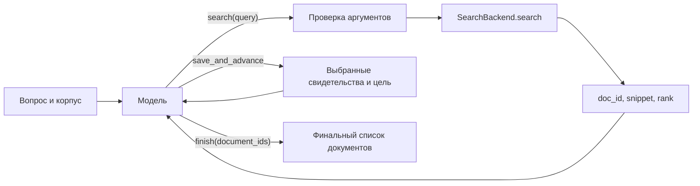

# Как работает поиск документов в RAG

> Это поиск документов задачи. Поиск истории сессий и постоянных записей относится к [MEMORY_CORE.md](MEMORY_CORE.md); индексы и правила доступа не смешиваются.

Модель формулирует запрос, читает сниппеты и выбирает финальные ID. OpenAI Agents SDK исполняет цикл. Поиск подключается через `SearchBackend`. Синтетические примеры используют фиксированную выдачу. Текстовый бенчмарк поддерживает локальные SQLite/FAISS-снимки и HTTP-индекс с контрактом T-Search. [Команды запуска](EXPERIMENTS.md#закрытый-бенчмарк-текстового-поиска).



## Один поиск по шагам

1. `AgentTask` задаёт вопрос, язык, `corpus_id` и необязательную `corpus_revision`. Модель видит задачу, системный промпт и схемы инструментов.
2. Модель вызывает `search(query)`. В раундовом режиме доступен необязательный `top_k` до `search_limit`. Харнесс берёт корпус и ревизию из задачи.
3. `execute_tool` проверяет аргументы и вызывает `await search.search(query, corpus_id=..., corpus_revision=..., limit=...)`.
4. Бэкенд возвращает `SearchHit`. Харнесс проверяет типы, ограничивает объём наблюдения и сохраняет порядок и `rank`. В раундовом режиме также фильтруются уже показанные в раунде и перенесённые ID.
5. Модель получает JSON `{"ok": true, "hits": [...]}` сообщением `role="tool"` с исходным `tool_call_id`.
6. Модель выбирает новый поиск, `finish` либо, при доступном следующем раунде, `save_and_advance`. В раундовом `finish` доступны до десяти ID из текущего контекста.

Пример наблюдения:

```json
{
  "ok": true,
  "hits": [
    {
      "doc_id": "doc-001",
      "snippet": "Срок проекта перенесён на 15 ноября.",
      "rank": 1
    }
  ]
}
```

`search_limit=10` и `max_snippet_chars=2000` по умолчанию задают размер выдачи одного вызова. Число поисков выбирает модель. Необязательные `max_steps` и `max_output_tokens` относятся ко всему эпизоду. Вызовы из одного ответа исполняются последовательно; независимые эпизоды идут параллельно через `RolloutRunner`.

Пустой список в `finish` допустим, обязательного поиска перед ним нет. Неправильные аргументы и придуманный id возвращаются модели для исправления. Сбой сервиса или неверный формат его ответа останавливают эпизод как `infrastructure_error`, без нулевой оценки за предполагаемо неверный ответ.

## Локальные BM25 и Jina/FAISS

При сборке один JSONL фиксирует ID и тексты корпуса. Тексты хранятся в SQLite, где FTS5 строит лексический индекс. `llama.cpp` считает 1024-мерные эмбеддинги Jina, а сборщик нормализует векторы документов и сохраняет их в FAISS вместе с привязкой к строкам SQLite. Во время прогона все эпизоды переиспользуют снимки, а Jina кодирует поисковые запросы.

| Режим | Что ранжирует выдачу |
|---|---|
| `bm25` | SQLite FTS5 по словам запроса |
| `dense` | Jina и точный косинусный поиск FAISS. SQLite отдаёт текст по найденным ID |
| `hybrid` | Обе выдачи объединяются через Reciprocal Rank Fusion с параметром 60 |

Для пилота HyDRA есть отдельный адаптер с векторами из хешированных слов и изоляцией индексов на эпизод. [HYDRA_PILOT.md](HYDRA_PILOT.md).

## Контекст между раундами

`save_and_advance` переносит выбранные свидетельства, резюме, нерешённые вопросы и цель. Новый раунд начинается с исходной задачи и перенесённых данных. В публичной истории сохраняются все раунды. Контекст сбрасывается на следующей задаче. [Контракты](CONTRACTS.md#минимальный-цикл-и-действия).

## Что делает мок

`MockSearch` проверяет совпадение корпуса и ревизии, записывает запрос для теста и возвращает заранее заданные документы до `limit`. Текст запроса на состав и порядок выдачи не влияет. В retrieval-примере документы берутся из `examples/fixtures/search_hits.json`; в hybrid — из `environment/demo.py`.

Текущие демо не содержат полнотекстового/векторного индекса, embeddings, chunking или reranker. Нет и отдельного инструмента чтения полного документа: модель работает с показанными сниппетами. API-модель вместо мока меняет формулировки запросов и выбор документов, но сама по себе не заменяет `MockSearch` реальным поиском.

RAG-прототип возвращает `selected_document_ids`, а не развёрнутый текстовый ответ. В hybrid-демо доступен ещё `sql(query)`, а `finish(answer, document_ids)` возвращает id заказов и источников. Общий формат ответа с текстом и цитатами ещё согласуется с Вовой и Колей.

## Как подключается бэкенд

Python-интерфейс определён в [contracts/types.py](../src/search_rl_env/contracts/types.py):

```python
async def search(
    query: str,
    *,
    corpus_id: str,
    corpus_revision: str | None,
    limit: int,
) -> list[SearchHit]:
    ...
```

Объект с этим методом передаётся как `search` в `run_episode` или `RolloutRunner`. Он использует снимок корпуса и возвращает `doc_id`, `snippet`, `rank`. Выдача сохраняет ID единицы поиска. В TRuST оценщик вычисляет родительский ID после отсечения первых десяти позиций.

HTTP-клиент `SearchClient` работает с локальным [Python-сервисом](SEARCH_BACKEND.md). Для сопоставимого прогона с T-Search клиент `ReferenceSearch` использует отдельный контракт `POST /search`. Его обслуживает внешний процесс с зафиксированным публичным корпусом.

Метод бэкенда вызывается в процессе SDK. Клиент поиска может быть общим для параллельных эпизодов. У каждого эпизода свой диалог и набор показанных id.

## Проверка после подключения

На фиксированной ревизии корпуса проверьте нужные документы по нескольким известным запросам, соответствие id разметке, порядок и размер выдачи, обработку отсутствующего корпуса и сбоя, затем параллельные эпизоды. Отличайте качество выдачи поиска от качества финального выбора модели.

Встроенная награда для локальных задач и `evaluate` для текстовых бенчмарков используют отдельные входы оценщика. Бенчмарк измеряет Recall@10 финального ранжирования и recall всех показанных свидетельств. Для корректности текстового ответа нужен отдельный оценщик.

Запуск, формат результата и примеры подключения команды — в [HARNESS_HANDOFF.md](HARNESS_HANDOFF.md).
