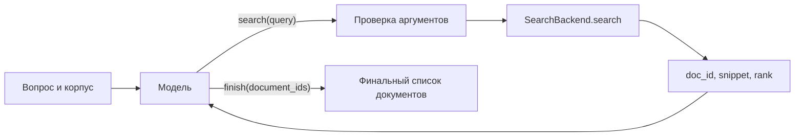

# Как работает поиск документов в RAG

Сейчас реализован агентный цикл поиска: модель формулирует запрос, получает документы со сниппетами, при необходимости ищет снова и выбирает финальные id. В поставляемых демо выдача фиксированная. Отдельный Go-сервис с SQLite FTS5 уже доступен через HTTP-клиент `SearchClient`; его правила и подключение описаны в [SEARCH_BACKEND.md](SEARCH_BACKEND.md). Устройство индекса не является частью харнесса.



## Один поиск по шагам

1. `AgentTask` задаёт вопрос, язык, `corpus_id` и необязательную `corpus_revision`. Модель видит задачу, системный промпт и схемы инструментов.
2. Модель вызывает `search` с единственным аргументом `query`. Корпус не выбирается текстом tool call: харнесс берёт его и ревизию из задачи.
3. `execute_tool` проверяет аргументы и вызывает `await search.search(query, corpus_id=..., corpus_revision=..., limit=...)`.
4. Бэкенд возвращает `SearchHit`. Харнесс проверяет типы, удаляет повторные id в выдаче, ограничивает число показанных результатов и длину сниппетов. Порядок и `rank` бэкенда сохраняются; дополнительного ранжирования в обвязке нет.
5. Модель получает JSON `{"ok": true, "hits": [...]}` сообщением `role="tool"` с исходным `tool_call_id`. Результаты предыдущих поисков остаются в контексте.
6. Модель сама выбирает следующий запрос либо `finish`. В финале разрешены только показанные id; повторы удаляются с сохранением порядка.

Пример наблюдения:

```json
{
  "ok": true,
  "hits": [
    {
      "doc_id": "doc-001",
      "snippet": "Срок проекта перенесён на 15 ноября.",
      "rank": 1
    }
  ]
}
```

`search_limit=10` и `max_snippet_chars=2000` по умолчанию задают размер выдачи одного вызова. Число поисков выбирает модель. Необязательные `max_steps` и `max_output_tokens` относятся ко всему эпизоду. Вызовы из одного ответа исполняются последовательно; независимые эпизоды идут параллельно через `RolloutRunner`.

Пустой список в `finish` допустим, обязательного поиска перед ним нет. Неправильные аргументы и придуманный id возвращаются модели для исправления. Сбой сервиса или неверный формат его ответа останавливают эпизод как `infrastructure_error`, без нулевой оценки за предполагаемо неверный ответ.

## Что делает мок

`MockSearch` проверяет совпадение корпуса и ревизии, записывает запрос для теста и возвращает заранее заданные документы до `limit`. Текст запроса на состав и порядок выдачи не влияет. В retrieval-примере документы берутся из `examples/fixtures/search_hits.json`; в hybrid — из `environment/demo.py`.

Текущие демо не содержат полнотекстового/векторного индекса, embeddings, chunking или reranker. Нет и отдельного инструмента чтения полного документа: модель работает с показанными сниппетами. API-модель вместо мока меняет формулировки запросов и выбор документов, но сама по себе не заменяет `MockSearch` реальным поиском.

RAG-прототип возвращает `selected_document_ids`, а не развёрнутый текстовый ответ. В hybrid-демо доступен ещё `sql(query)`, а `finish(answer, document_ids)` возвращает id заказов и источников. Общий формат ответа с текстом и цитатами ещё согласуется с Вовой и Колей.

## Где подключается реальный поиск Димы

Python-интерфейс определён в [contracts/types.py](../src/search_rl_env/contracts/types.py):

```python
async def search(
    query: str,
    *,
    corpus_id: str,
    corpus_revision: str | None,
    limit: int,
) -> list[SearchHit]:
    ...
```

Объект с этим методом передаётся как `search` в `run_episode` или `RolloutRunner`. Он выбирает нужный снимок корпуса, выполняет реальный поиск и возвращает только поля контракта: `doc_id`, `snippet`, `rank`. Харнесс не зависит от способа построения индекса. id должны быть стабильны внутри ревизии и согласованы с эталонами Вовы; преобразование chunk id в document id при необходимости выполняет адаптер поиска.

Дима владеет хранением, индексом, способом поиска и его параметрами. Сергей — tool calling, контекстом, наблюдениями, обработкой ошибок и циклом. Вова — эталонами и оценщиком. Коля — набором запросов, запуском и сравнением вариантов. Промышленный HTTP-протокол пока не согласован; локальный `/search` адаптера служит транспорту харнесса.

В обычном режиме `in_process` метод бэкенда вызывается напрямую, без MCP-процесса на каждый эпизод. Прежний режим `subprocess` + MCP сохранён. Клиент поиска может быть общим для параллельных эпизодов, состояние диалога и набор показанных id остаются отдельными.

## Проверка после подключения

На фиксированной ревизии корпуса проверьте нужные документы по нескольким известным запросам, соответствие id разметке, порядок и размер выдачи, обработку отсутствующего корпуса и сбоя, затем параллельные эпизоды. Отличайте качество выдачи поиска от качества финального выбора модели.

Встроенная retrieval-награда — Recall@10 по финальным выбранным id при наличии приватного эталона. Она не оценивает правильность содержательного ответа и не заменяет метрику общего RAG-бенчмарка. Успешный эпизод на фиксированной моковой выдаче подтверждает взаимодействие компонентов.

Запуск, формат результата и примеры подключения команды — в [HARNESS_HANDOFF.md](HARNESS_HANDOFF.md).
