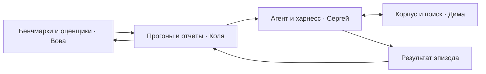

# План структуры репозитория

Целевая постановка — Text-to-SQL + RAG, см. [AGENT_SCOPE.md](AGENT_SCOPE.md). Дима ведёт SQL-схемы, снимки и ручку выполнения; Сергей — инструменты агента и ответ. Оценка включает SQL-only, RAG-only и hybrid; train-источники и внутренний dev фиксируются по [EXPERIMENTS.md](EXPERIMENTS.md). После передачи харнесса Коля с Димой ведут baseline/скорость, Сергей с Вовой — данные GEPA/SFT. Владельцы модулей сохраняются.

План от 2026-10-31. Уже созданы `pyproject.toml`, пакет с `contracts/`, `agent/` и `environment/`, конфиги Verifiers, пример запуска с моками и тесты. Остальные части дерева ниже — целевая структура, они добавляются с реализациями соответствующих компонентов.

## Целевая структура

```text
search-rl-env/
├── README.md
├── CONTRIBUTING.md
├── AGENTS.md
├── .github/
│   ├── ISSUE_TEMPLATE/task.md
│   └── pull_request_template.md
├── pyproject.toml                 # установка пакета и pytest
├── src/search_rl_env/
│   ├── contracts/                 # общие типы и интерфейсы
│   ├── agent/                     # запуск Verifiers, промпты и клиенты моделей
│   ├── environment/               # Taskset, Task, MCP-инструменты и награда
│   ├── training/                  # сбор роллаутов и обучение
│   ├── search/                    # хранение корпуса, индексы и поисковые ручки
│   ├── benchmarks/                # задачи, метрики, эталоны и джаджи
│   └── evaluation/                # запуск бенчмарков, отчёты и сравнение
├── configs/
│   ├── agent/
│   ├── search/
│   ├── benchmarks/                # включая версии источников и манифесты
│   ├── evaluation/
│   └── training/
├── examples/fixtures/             # небольшой синтетический пример
├── tests/
│   ├── unit/
│   └── integration/
├── scripts/                      # вспомогательные команды
└── docs/
```

## Владельцы и содержание

| Каталог | Владелец | Что здесь находится |
|---|---|---|
| `agent/`, `environment/`, `training/` | Сергей | Цикл модели и инструментов, история, контекст, лимиты эпизода, финализация, клиенты моделей, RL |
| `search/` | Дима | Загрузка и хранение документов, индексация, поиск, чтение по id, ошибки и телеметрия бэкенда |
| `benchmarks/` | Вова | Подготовка задач, адаптеры наборов, правила разбиения, расчёт метрик, конфиги и логика джаджей |
| `evaluation/` | Коля | Выбор задач, пакетный запуск харнесса, повторы, возобновление, выполнение оценщиков, MLflow и сравнение прогонов |
| `contracts/` | Владельцы соединяемых компонентов | Форматы задач, результатов поиска, эпизодов и оценок; без вызовов API и базы данных |
| `tests/` | Автор изменяемого компонента | Проверки рядом с соответствующей логикой по структуре, например `tests/unit/search/` |
| `examples/fixtures/` | Вова и Коля | Документы, задачи и ожидаемые результаты для небольшого автономного примера |

Конфиги и вспомогательные скрипты принадлежат владельцу соответствующего компонента. Ядро логики находится в пакете; `scripts/` содержит только тонкие команды для его запуска.

## Направление взаимодействия



Коля использует публичный вызов харнесса и интерфейс оценщика. Харнесс использует интерфейс поиска. Модуль поиска не зависит от конкретной модели или бенчмарка. Оценщику доступны эталоны; агенту передаётся только разрешённая часть задачи. Минимальные границы описаны в [CONTRACTS.md](CONTRACTS.md).

## Данные и артефакты

Локальные `data/`, `indexes/`, `models/`, `checkpoints/`, `runs/`, `logs/` и каталоги MLflow исключены из Git. Данные воспроизводятся по отслеживаемым манифестам: источник, версия, лицензия, контрольные суммы и способ подготовки.

В `examples/fixtures/` храним только небольшой синтетический набор с проверенными ожидаемыми результатами. Большой публичный бенчмарк не копируем в репозиторий. Расшифрованные вопросы защищённых оценочных наборов не публикуем.

## Первое добавление кода

Первый Python-PR создаёт `pyproject.toml`, нужный модуль, минимальные зависимости и реальные команды установки и проверки в README. Пустые модули заранее не считаются реализацией. Для проверки границ сначала достаточно подставного клиента модели, фиксированного ответа поиска и ручного результата оценщика.
